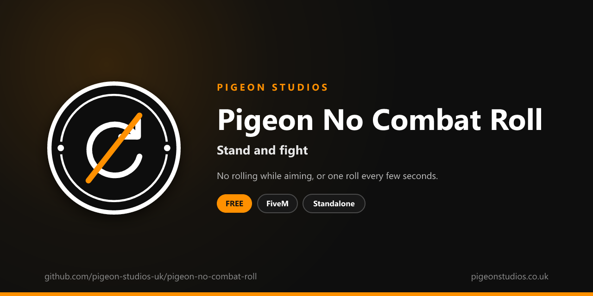

<div align="center">
  

  <h1>Pigeon No Combat Roll</h1>

  <p><strong>Stops players combat rolling while they aim a gun, or limits them to one roll every few seconds.</strong></p>

  <p>
    <a href="https://github.com/pigeon-studios-uk/pigeon-no-combat-roll/releases/latest"></a>
    <a href="LICENSE.md"></a>
    <a href="https://discord.gg/2NFVWEUmDF"></a>
    
  </p>

  <p>
    <a href="https://github.com/pigeon-studios-uk/pigeon-no-combat-roll/releases/latest"><strong>Download</strong></a> ·
    <a href="#installation">Install</a> ·
    <a href="#configuration">Configure</a> ·
    <a href="CHANGELOG.md">Changelog</a> ·
    <a href="https://discord.gg/2NFVWEUmDF">Support</a>
  </p>
</div>

---

## Contents

- [Overview](#overview)
- [Features](#features)
- [Requirements](#requirements)
- [Installation](#installation)
- [Updating](#updating)
- [Configuration](#configuration)
- [Localisation](#localisation)
- [How it works](#how-it-works)
- [Update checker](#update-checker)
- [Performance](#performance)
- [Security](#security)
- [Troubleshooting](#troubleshooting)
- [FAQ](#faq)
- [Support](#support)
- [Contributing](#contributing)
- [Licence](#licence)
- [Credits](#credits)

## Overview

Pigeon No Combat Roll is a free resource by [Pigeon Studios](https://pigeonstudios.co.uk) that stops combat roll spam. In GTA, pressing jump while aiming a gun makes the character roll sideways, and players learn to roll over and over in a gunfight to make themselves almost impossible to hit. On roleplay and tactical servers that turns every shootout into a rolling contest.

With this resource, players can't roll while they aim. Or, if you'd rather keep the move, they can roll once and then have to wait.

## Features

- **No rolling while aiming.** The roll is blocked the moment a player aims a gun.
- **Or a cooldown.** Allow one roll every few seconds instead.
- **Jumping still works.** Without aiming, the jump key works as normal, gun in hand or not.
- **Melee and unarmed untouched.** Only guns and throwables are checked.
- **Optional message.** Tell players why they didn't roll, through ox_lib if you have it or GTA's own notifications.
- **Translatable.** The messages are in `locales/`.
- **Standalone.** No framework or other resources needed.

## Requirements

| Requirement | Version | Notes |
|---|---|---|
| FXServer | A [recommended artifact](https://runtime.fivem.net/artifacts/) | |
| [ox_lib](https://github.com/communityox/ox_lib) | Optional | The message if it's running |

**Frameworks:** none needed. It works the same on standalone servers, ESX Legacy, QBCore, Qbox and ox_core.

## Installation

1. **Download** `pigeon-no-combat-roll.zip` from the [latest release](https://github.com/pigeon-studios-uk/pigeon-no-combat-roll/releases/latest). Don't use the green **Code** button; release zips are the tested builds.
2. **Extract** it into your server's `resources` folder. The folder must be called `pigeon-no-combat-roll`.
3. **Start it** by adding this to `server.cfg`, after ox_lib if you use it:

   ```cfg
   ensure pigeon-no-combat-roll
   ```

4. **Configure** it in `configuration/config.lua` if you want to change anything. The defaults work as they are.
5. **Restart** your server. The console shows one line from the update checker:

   ```text
   [Pigeon Studios] Pigeon No Combat Roll v1.0.0 is up to date.
   ```

## Updating

1. Read the [changelog](CHANGELOG.md) for every version between yours and the latest, especially any **Upgrade notes**.
2. Back up your `configuration/` and `locales/` folders.
3. Replace the `pigeon-no-combat-roll` folder with the new release.
4. Copy your changed settings into the new `configuration/config.lua`. Don't copy the old file over the new one; new versions can add settings.
5. Restart the resource.

## Configuration

All settings are in `configuration/config.lua`, each explained by a comment next to it.

| Setting | Default | What it does |
|---|---|---|
| `Config.Locale` | `'en'` | Language file from `locales/` |
| `Config.Mode` | `'never'` | `'never'`: no rolling while aiming. `'cooldown'`: one roll, then wait |
| `Config.CooldownSeconds` | `5` | Seconds between rolls with `'cooldown'` |
| `Config.ShowMessage` | `false` | Tell players why they didn't roll |
| `Config.MessageCooldown` | `4` | Seconds between messages |
| `Config.Notifications` | `'auto'` | `'auto'` (ox_lib if it's running, otherwise GTA's notification feed), `'ox_lib'` or `'gta'` |

## Localisation

Set `Config.Locale` to a file in `locales/`. To add a language, copy `locales/en.lua` to a new file named with the language's two-letter code (such as `de.lua`), change `Locales.en` at the top to match (`Locales.de`), and translate the text in quotes. We'd love it if you shared it back; see [Contributing](#contributing).

## How it works

Four times a second, the resource checks whether the player is on foot and holding a gun or throwable. While they are, it checks every frame whether they're aiming. If they are, the jump control (`INPUT_JUMP`, 22), which does the roll while aiming, is disabled for that frame.

With `Config.Mode = 'cooldown'`, the jump control is left alone until the player rolls, then disabled while aiming until `Config.CooldownSeconds` have passed.

It only affects the player's own character, so every player needs it running, which FiveM does automatically for client scripts.

## Update checker

When it starts, Pigeon No Combat Roll checks our public [version registry](https://github.com/pigeon-studios-uk/pigeon-versions) once and prints one line in the server console saying whether it's up to date. If there's an update, it shows what's new and where to get it. The check is a single request to GitHub and sends nothing about your server or players.

Control it for every Pigeon Studios resource at once in `server.cfg`:

```cfg
set pigeon_update_check "on"      # default: one line per resource
set pigeon_update_check "quiet"   # only when there's an update or a problem
set pigeon_update_check "off"     # never check
```

## Performance

Without a gun in hand it checks four times a second and does nothing else. Holding a gun, it runs every frame, which costs very little: a couple of aiming checks and one control. Nothing runs on the server apart from the update check at start-up.

## Security

- It runs only in each player's own game and only blocks that player's own controls.
- It has no commands, exports or network events, so there is nothing other players, other resources or the server can send it.
- The only network request is the update check at start-up, from the server to GitHub. It sends nothing about your server or players.
- It sends notifications through ox_lib's local `ox_lib:notify` event when ox_lib is running. Nothing leaves the player's game.
- Like every rule that runs in the player's game, a player with a modified game could get around it. It's a gameplay rule, not an anti-cheat; pair it with your anti-cheat if that matters on your server.

Found a problem? Please don't open a public issue. Use the **Report a vulnerability** button in this repository's **Security** tab, or follow our [Security Policy](https://github.com/pigeon-studios-uk/.github/blob/main/SECURITY.md).

## Troubleshooting

**Players can still roll.**
Check the resource is started (`ensure pigeon-no-combat-roll`) and there are no errors in the F8 console. With `Config.Mode = 'cooldown'`, one roll every `Config.CooldownSeconds` is allowed.

**Players can't jump at all.**
Jumping is only blocked while aiming. If players can't jump without aiming either, another resource is blocking it: stop this one and test again.

**The console says "isn't in the version registry" or "couldn't check for updates".**
Your server couldn't reach GitHub, or the check is blocked by a firewall. The resource works normally either way. Turn the check off with `set pigeon_update_check "off"`.

## FAQ

**Is it really free?**
Yes. Use it on as many servers as you like, including ones that take donations. You just can't reupload, resell or bundle it. See [Licence](#licence).

**Can players still dive out of the way of a car?**
Yes, unless they're aiming a gun at the time.

**Does it affect NPCs?**
No. It only changes what players can do.

**Does it stop bunny hopping?**
No. It only blocks the jump while aiming, which is the roll.

## Support

Read [Troubleshooting](#troubleshooting) first, then ask in the support channels of our [Discord](https://discord.gg/2NFVWEUmDF). Please include your Pigeon No Combat Roll version, FXServer artifact and any errors from the console. See [Getting help](https://github.com/pigeon-studios-uk/.github/blob/main/SUPPORT.md).

Found a bug? Open a [bug report](https://github.com/pigeon-studios-uk/pigeon-no-combat-roll/issues/new/choose).

## Contributing

Fixes, improvements and translations are welcome. Please read the [contributing guide](https://github.com/pigeon-studios-uk/.github/blob/main/CONTRIBUTING.md) first, and open a feature request before working on anything big.

## Licence

Pigeon No Combat Roll is free to use under the **[Pigeon Studios Free Licence](LICENSE.md)**.

- ✅ Use it on any number of servers, including monetised ones
- ✅ Change it for your own servers
- ✅ Show it in videos and streams
- ❌ Don't reupload, share or mirror the files; link to this repository instead
- ❌ Don't sell it, bundle it in packs, or put it behind escrow
- ❌ Don't remove the credits

This summary isn't the licence; [LICENSE.md](LICENSE.md) is. Third-party notices are in [NOTICE.md](NOTICE.md).

## Credits

Made by [Pigeon Studios](https://pigeonstudios.co.uk).

<sub>Not affiliated with or endorsed by Rockstar Games, Take-Two Interactive or Cfx.re.</sub>
